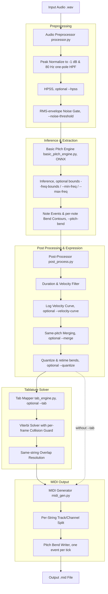

# System Design Specification - Polyphonic Guitar-to-MIDI Enhancements

## 1. Architecture Overview & Data Flow

The system architecture expands the pipe-and-filter pipeline with optional pre-processing filters, model configuration hooks, logarithmic velocity transformers, Viterbi tab solving, and pitch-bend MIDI generation.

---

## 2. Component Design & Enhancements

### 2.1 Audio Preprocessor ([`src/processor.py`](file:///E:/sw_ws/repo1/audio2midi/src/processor.py))
- **`hpss_filter(audio, margin=1.0)`**: Uses `librosa.effects.hpss` to separate harmonic audio from percussive clicks.
- **`high_pass_filter(audio, sr, cutoff=80)`**: One-pole RC high-pass, `y[n] = α·(y[n-1] + x[n] - x[n-1])`, evaluated via `scipy.signal.lfilter` with `b = [α, -α]`, `a = [1, -α]` and `y[0] == x[0]`. Not a Butterworth, despite earlier revisions of this document.
- **`noise_gate(audio, threshold, frame_length, hop_length, smoothing_frames)`**: Thresholds a smoothed short-term RMS envelope and applies the result as a gain curve, so note decay tails are attenuated smoothly rather than clipped sample-by-sample. This supersedes the `apply_spectral_denoise(audio, sr)` entry point named in earlier revisions, which was never implemented; it satisfies the FR-02 intent of protecting decay tails from a hard gate.

### 2.2 ML Engine ([`src/basic_pitch_engine.py`](file:///E:/sw_ws/repo1/audio2midi/src/basic_pitch_engine.py))
- Extends `transcribe()` to accept `min_freq`, `max_freq` (default `None`, i.e. unbounded; the CLI's `--freq-bounds` supplies 80 / 1400 Hz), `onset_threshold`, `frame_threshold`, `min_note_len`, `include_pitch_bends`.
- Reads each note's **own** bend contour from the fifth element of its `predict()` note event (units of 1/3 semitone). Values scale by $4096/3$ into MIDI pitch-wheel units (4096 per semitone, assuming the receiver's default ±2-semitone bend range, so wider bends clip), clamped to the 14-bit signed range $[-8192, 8191]$; times are `linspace(start, end, len(contour))`. Emitted as dicts `{'pitch': int, 'time': float}`.
- Bends are **not** matched to notes by time window: a bend is owned by exactly one note by construction, so a single string's bend is never copied onto simultaneously sounding notes.
- Velocity is clamped to $[1, 127]$; a velocity of 0 is a note-off in most DAWs.
- Pinned to the ONNX model (`MODEL_PATH`); left to its default, `basic-pitch` picks whichever runtime is importable.
- Detection defaults are defined once (`DEFAULT_ONSET_THRESHOLD` 0.5, `DEFAULT_FRAME_THRESHOLD` 0.3, `DEFAULT_MIN_NOTE_LENGTH_MS` 127.7) and imported by the CLI. They are Basic Pitch's own values, kept because they hold recall on imperfect recordings. `CLEAN_RECORDING_*` (0.6 / 0.5 / 58 ms) are the opt-in values for clean recordings: they reach onset F1 0.822 vs 0.775 on held-out GuitarSet players, but lose audible note events on the less controlled fixtures.
- Pitches are filtered exactly as Basic Pitch bins them, `round(min)` to `round(max)` exclusive, so 80–1400 Hz keeps MIDI 39–88 (D#2–E6).

### 2.3 Post-Processor ([`src/post_process.py`](file:///E:/sw_ws/repo1/audio2midi/src/post_process.py))
- **`apply_logarithmic_velocity(notes, curvature=5.0)`**: Maps linear model amplitude $a \in [0, 1]$ to MIDI velocity $V \in [1, 127]$:
  $$V = \text{round}\left(127 \times \frac{\ln(1 + k \cdot a)}{\ln(1 + k)}\right)$$
- **`quantize_notes(notes, bpm, grid_resolution, strength=1.0)`**: Applies partial quantization strength interpolation, writing `start_ticks`/`end_ticks` at 480 ticks per quarter:
  $$t_{\text{final}} = t_{\text{original}} + \text{strength} \times (t_{\text{quantized}} - t_{\text{original}})$$
- **`ticks_to_seconds(notes, bpm)`**: Applies those tick values back to `start`/`end`, and maps each note's bend times onto the new span. Without this, bends keep their pre-quantization absolute times and fall outside the note that owns them.
- **`merge_notes(notes)`**: Groups by pitch and merges consecutive same-pitch notes that overlap (or fall within 50 ms) **while another pitch is sounding through them** — the marker distinguishing engine chatter from a genuine re-pluck. The concurrency test binary-searches the start-sorted list over a bounded time window, so cost scales with window density rather than $N$. Earlier revisions described this as a sweep-line; it is not, and the vestigial unused event list has been removed. Merges carry the absorbed note's bend contour. **Opt-in (`--merge`), off by default:** on 20 GuitarSet tracks it cost 17 points of onset recall for 3 of precision (onset F1 0.742 → 0.646), confirmed on the held-out test players (0.775 → 0.693; chords 0.711 → 0.554), because the end-to-start gap test also absorbs notes that merely sustained until the same pitch was played again.

### 2.4 Tablature Engine ([`src/tab_engine.py`](file:///E:/sw_ws/repo1/audio2midi/src/tab_engine.py))
- **`TabMapper`** (named `ViterbiTabSolver` in earlier revisions of this document):
  - State space $S$: valid collision-free `(string, fret)` **frame assignments** — the Cartesian product of per-note placements across one chord frame, not a single note's placements.
  - Emission Cost $E(s)$, applied at **every** frame: $\overline{|f_{\text{fretted}} - 5|} + p_{\text{open}} \cdot \frac{|\{f = 0\}|}{|s|}$ with $p_{\text{open}} = 8$: the mean of each fretted note's own distance from fret 5, plus an open-string **penalty**.
    - *Per-note distance.* Earlier revisions used the distance of the *mean* fret, $|\overline{f} - 5|$, which scores frets 1 + 9 the same as 5 + 5 and so lets chords stretch beyond any hand. Held-out players: 0.516 → 0.610 (chords 0.491 → 0.672).
    - *Open-string penalty.* An open string is otherwise free in both terms: it adds nothing to the position term, and the transition cost is 0 into or out of a frame without fretted notes, so the hand also moves through it for free. Earlier revisions added a bonus ($-3$) on top, and the solver took open strings wherever a melody allowed. That was why it trailed a naive nearest-to-fret-5 placement on single-note lines. Accuracy on the dev split rises with the penalty and plateaus from about 8; the held-out test players then gave 0.610 → **0.664** (chords 0.672 → 0.715, single-note lines 0.547 → 0.612), ahead of the baseline (0.644). Carrying the hand position through open frames instead was tried and added nothing on top.
    - Open strings are excluded from the position average because they do not constrain the fretting hand, and the penalty is averaged over the frame so it does not grow with polyphony. Applying this only at frame 0 (as earlier revisions did) leaves absolute neck position unanchored for the rest of the piece.
  - Transition Cost $C(s_i, s_{i+1})$: $w_{\text{fret}} \cdot |\overline{f_{i+1}} - \overline{f_i}| + w_{\text{string}} \cdot |\overline{s_{i+1}} - \overline{s_i}|$, with $w_{\text{fret}} = 1.5$, $w_{\text{string}} = 0.5$, and **0 whenever either frame has no fretted note** (there is no hand position to measure from). That zero is what made open strings free to pass through before the penalty above. The open-string term lives in the emission cost only; counting it here as well double-counts it once per transition.
  - Time complexity: $O(T \cdot K^2)$ over $T$ chord frames, where $K$ is the candidate count per frame. $K$ is the size of an unbounded Cartesian product, so it is capped (`max_candidates`, default 64) by keeping the lowest-emission-cost candidates. Measured $K$ for real chords is 1–34.
- **Fret limit** (`max_frets`, default 15): measured on GuitarSet rather than set to a neck length. Raising it to 19–24 recovered no matched note and lowered string accuracy (dev split, current costs: 0.601 at 15, 0.596 at 19, 0.593 at 24) at ~3× solve time; detections above fret 15 were spurious. 12 scored the same within noise but would strand real high-neck notes. Out-of-reach pitches route to the default track.
- **Chord Collision Guard**: Enforces that for notes with $|t_{\text{onset}, A} - t_{\text{onset}, B}| < 15\text{ms}$, $s_A \neq s_B$. Pitches with no valid placement fall back to $(0, -1)$ and route to the default track.
- **Same-string Overlap Resolution** (`_resolve_string_overlaps`, after the solver): the collision guard only sees one 15 ms frame, so a note sustaining across frames can still overlap a later note on its own string. A later pluck at least `MIN_REPLUCK_SECONDS` (50 ms) after the earlier note's onset truncates the earlier note to that pluck (dropping its bends past the new end), as a real string would. A closer pair is two voices the solver could not separate, not a re-pluck: the earlier note keeps its length and gives up its string (`string = 0`, `fret = -1`, unassigned track). Result: no two simultaneous notes share a string.
- **Collision Fallback** (`_best_effort_assignment`): when the frame admits no collision-free combination — more than six simultaneous notes, or duplicate detections of a single-placement pitch — an exact bipartite matching (augmenting paths, most-constrained note first) maximizes the count of notes on distinct strings, and any remainder takes its placement closest to $\text{PREFERRED\_FRET}$. Earlier revisions took each note's first placement, which could pile four notes onto string 6 while strings 1–5 sat free. See the FR-06 note in [`requirements.md`](./requirements.md) for why a residual collision is unavoidable rather than a solver defect.

### 2.5 MIDI Generator ([`src/midi_gen.py`](file:///E:/sw_ws/repo1/audio2midi/src/midi_gen.py))
- Creates one `pretty_midi.Instrument` per string (Strings 1–6) when tab mode is enabled; each becomes its own track and channel on write. Because a physical string sounds one note at a time, each voice gets an independent bend stream. `pretty_midi` allocates the literal channel numbers itself, so the design controls the track split rather than fixed channel indices.
- Writes note events and each note's pitch bend events per track, clamped to $[-8192, 8191]$, with consecutive redundant values dropped and a recentre to 0 at each note's end so bends do not bleed into the next note on that channel. Exactly one pitch-wheel event survives per MIDI tick, because `pretty_midi` writes same-tick pitch-wheel events sorted by value rather than by intent. The survivor is the one meant to be in force: the later-starting note's, and within a note the later in time, so a recentre beats its note's own last bend and the next note's first bend beats the previous note's recentre. Bends timed after their note's end are dropped.
- Without `--tab` (and for notes whose string was withdrawn) everything shares the default track, hence one channel: a bend there applies to every note sounding at once. The CLI warns when `--pitch-bend` is used without `--tab`.

---

## 3. Technology Stack & Infrastructure

- **Language:** Python 3.10.x
- **Pre-processing:** `librosa` (0.10+), `scipy.signal`, `numpy` (<2.0.0)
- **ML Engine:** `basic-pitch` (Spotify) 0.4+, running its ONNX model on `onnxruntime`. The model is pinned in `basic_pitch_engine.MODEL_PATH`, and TensorFlow is not a dependency: the ONNX export gave note-for-note identical output to the TensorFlow SavedModel on every fixture.
- **MIDI Output:** `pretty_midi`
- **CLI Framework:** `click` (numeric options constrained with `IntRange`/`FloatRange`)
- **Testing & Benchmarking:** `pytest` (mocks via `unittest.mock`), `pytest-cov`, `mir_eval`, `pandas`
- **Lint & CI:** `ruff` (`ruff.toml`), GitHub Actions (`.github/workflows/ci.yml`) running lint plus the `not slow` suite with a branch-coverage gate (`.coveragerc`, `fail_under = 95`)
- **Packaging:** `setup.py` with flat `py_modules` under `src/`. `find_packages(where="src")` returns nothing here because `src/` holds modules rather than a package, and would install no code at all.

---

## 4. Performance & Complexity Analysis

| Operation | Complexity | Expected Bottleneck | Optimization Strategy |
| :--- | :--- | :--- | :--- |
| **High-Pass Filter** | $O(N)$ | Negligible when vectorized | `scipy.signal.lfilter`; a per-sample Python loop measured ~170x slower (1.25 s vs 0.007 s for 30 s @ 22.05 kHz) |
| **Audio HPSS** | $O(N \log N)$ FFT | Moderate CPU compute | Optional flag `--hpss`; process in STFT frame blocks |
| **Noise Gate** | $O(N)$ | Negligible | RMS envelope + gain interpolation, both vectorized |
| **Basic Pitch Inference** | $O(N)$ DNN Forward Pass | Primary Compute Bottleneck | Restrict frequency bounds; batch model execution |
| **Note Merging** | $O(N \log N + N \cdot W)$, $W$ = notes per time window | Low (~0.37 s for 20 000 notes) | Binary-search the start-sorted list instead of a full scan per candidate |
| **Viterbi String Solver** | $O(T \cdot K^2)$ over $T$ frames | Low; $K$ is an unbounded Cartesian product | Pre-computed pitch-to-(string,fret) LUT; cap candidates per frame at `max_candidates` (64) |
| **Log Velocity Mapping** | $O(N)$ | Negligible | Vectorized NumPy array operations |
| **MIDI Generation** | $O(N)$ | Negligible | Stream writing via `pretty_midi` |

---

## 5. Test Strategy & Isolation

- **Unit Testing (Isolated):**
  - [`processor.py`](file:///E:/sw_ws/repo1/audio2midi/src/processor.py): HPSS filter response, high-pass frequency cutoff validation.
  - [`post_process.py`](file:///E:/sw_ws/repo1/audio2midi/src/post_process.py): Velocity curve mathematical mapping, partial quantization interpolation.
  - [`tab_engine.py`](file:///E:/sw_ws/repo1/audio2midi/src/tab_engine.py): Viterbi path cost optimization, chord string collision guard.
- **Integration Testing (Component Mocking):**
  - Mock `basic-pitch` output using synthesized synthetic note tuples to verify post-processing and MIDI generation end-to-end without running ML inference during fast unit test runs.
- **End-to-End & Benchmark Testing:**
  - Full transcription pipeline run against the reference recordings in `tests/`, asserting note-count bands and output tempo. These are marked `slow` and deselected with `-m "not slow"`.
  - **Accuracy benchmark (manual):** `tools/evaluate_guitarset.py` scores against GuitarSet ground truth (the NFR accuracy target in `requirements.md`, currently not met). It needs the separately downloaded corpus, so it is not part of CI; the note-count bands remain a regression tripwire, not an accuracy measurement.
  - **Plausibility sweep:** `tools/analyze_transcription.py` ranks presets on the `tests/` fixtures using self-consistency metrics. It has no ground truth and measures no accuracy. Both tools share `tools/engine_cache.py`, whose key covers the engine source files so a changed default cannot serve stale inference.
